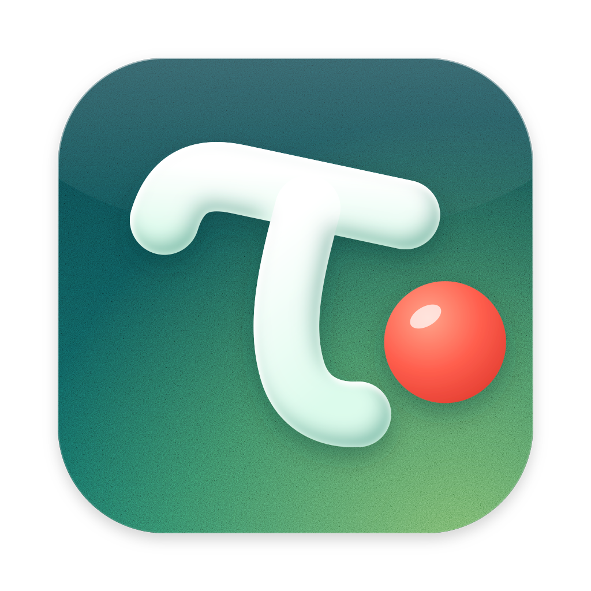

# Taudot <sup>alpha</sup>

Write your Overleaf papers in Neovim, on your Mac. Collaborators keep using overleaf.com; your edits reach them live,
under your name, and theirs reach you.

- **Your Neovim**, your config, drawn natively with pixel-smooth scrolling.
- **The PDF beside it**, typeset as you type (TeXpresso). Double-click or ⌘-click a word to jump to it in the source;
  ⌘⌥J jumps the other way.
- **Overleaf comments**: a faint highlight on commented text, a card when your cursor is in it. Reply, resolve, or
  select text and comment.
- **Overleaf's history stays as it is**: edits are batched the way the browser batches them.

## Install

Needs macOS 15+, the Xcode command line tools and Homebrew.

```console
$ git clone https://github.com/heyodog0/taudot && cd taudot
$ ./install.sh                     # builds everything, starts the sync engine at login
$ taudot login                    # takes your overleaf.com session from your browser
$ taudot clone https://www.overleaf.com/project/<id> ~/papers/mine
$ txs ~/papers/mine                # opens the app
```

`./install.sh` again updates after a `git pull`.

## Keys

| | |
|---|---|
| ⌘\\ | show or hide the PDF |
| ⇧⌘\\ | show or hide the comments margin |
| ⌥⌘M | comment on the selection |
| ⌘⌥J | show the cursor's line in the PDF |

## Docs

- [docs/mac-app.md](docs/mac-app.md): how the app is built.
- [docs/developing.md](docs/developing.md): what tests and builds need beyond `./install.sh` (Overleaf CE, reference
  builds, the TeX Live store).
- [docs/README.md](docs/README.md): design, Overleaf's protocol, the engine's API, and the development notes.

Built on [TeXpresso](https://github.com/let-def/texpresso) and [Neovim](https://neovim.io). Not affiliated with
Overleaf.

## Licence

AGPL-3.0 (`LICENSE`), with additional terms in `NOTICE`: copies and derived works keep the attribution "Based on
Taudot by Ryan Truong — https://github.com/heyodog0/taudot" where they show their legal notices or version, and a
modified version uses a different name. Directories with their own `LICENSE` keep it.
